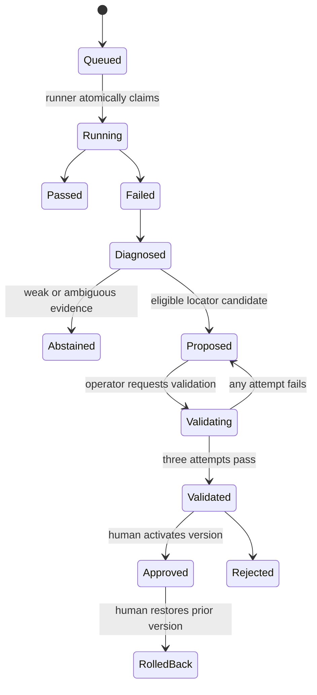

# Architecture and decisions

## Boundary

The edge runner lives inside the customer network. It is the only component that receives ERP credentials and raw Playwright traces. It claims jobs over outbound HTTPS and uploads a deliberately small, redacted diagnostic bundle. The cloud control plane cannot initiate arbitrary commands on the edge.

## Run state machine

## Why PostgreSQL row locking instead of a queue

The pilot has one runner and low job volume. `SELECT ... FOR UPDATE SKIP LOCKED` gives atomic claims without operating Redis and Celery. A dedicated broker becomes justified only when scheduling, fan-out or high concurrency appears.

## Why declarative JSON instead of Python generation

The allowed actions are navigate, click, fill, select, assert text/URL and wait. Schema validation rejects unknown actions and fields. Repair applies one locator replacement to a deep copy, validates the complete result and preserves downstream assertions. The LLM therefore cannot smuggle shell execution, credential changes or removed safety checks into a patch.

## Candidate scoring

Available evidence is normalized so missing attribute/context signals do not make the threshold unreachable. The initial weights are role `0.25`, name `0.35`, stable attributes `0.20`, and structural context `0.20`; unavailable dimensions are excluded and remaining weights are normalized. Eligibility additionally requires uniqueness, score `>= 0.82`, and top-two margin `>= 0.12`.

These are policy defaults, not universal truths. The evaluation report records where they work and requires later calibration on real failures.

## LLM boundary

Groq is optional. When configured, the model gets a deterministic diagnosis and may call up to five read-only tools over two turns. Tool results are bounded and sanitized. The final JSON is schema-checked, candidate ownership is rechecked in the database, and an LLM recommendation cannot override deterministic abstention.

## Validation isolation

The reset service owns Odoo database-administrator capability; the runner does not. After Odoo is seeded, `/snapshot` captures a clean compressed database. Before each validation attempt, the runner requests `/restore` using a separate token. The service is bound to localhost/customer Docker networking, serializes resets, terminates active sandbox connections, and restores the same snapshot.

