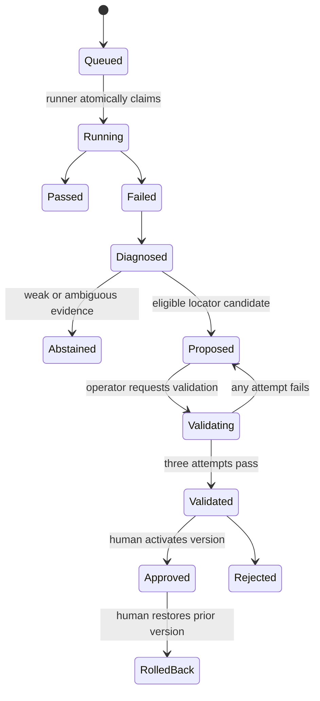

# Architecture

ChangeShield is built around one simple rule: the browser automation can touch the business system, but the model should never be allowed to act with full freedom. The architecture therefore separates execution, diagnosis, and approval into distinct steps.

## System boundary

The edge runner lives inside the customer network. It is the only component that receives ERP credentials and raw Playwright traces. It claims jobs over outbound HTTPS and uploads a small, redacted diagnostic bundle.

The cloud control plane stores run history, evidence, proposals, and approvals. It cannot directly execute arbitrary commands on the edge. That separation is the main safety boundary in the system.

## Main components

- Django control plane for workflows, runs, proposals, and audit history
- Playwright edge runner for browser execution against Odoo Community
- deterministic diagnosis layer for classifying failures and scoring candidates
- validation service for isolated retry runs
- human approval step before a new workflow version becomes active

## Run state machine

## Why PostgreSQL row locking instead of a queue

The pilot has one runner and low job volume. `SELECT ... FOR UPDATE SKIP LOCKED` gives atomic claims without operating Redis and Celery. A dedicated broker only becomes useful when scheduling, fan-out, or high concurrency appears.

This is a deliberate simplicity choice. The project is trying to prove the workflow and the failure-handling model first, not the scale-out infrastructure.

## Why declarative JSON instead of Python generation

The allowed actions are navigate, click, fill, select, assert text or URL, and wait. Schema validation rejects unknown actions and fields. Repair applies one locator replacement to a deep copy, validates the complete result, and preserves downstream assertions.

That choice keeps the model from smuggling shell execution, credential changes, or removed safety checks into a patch. It also keeps the repair review process understandable to a human reviewer.

## Candidate scoring

Available evidence is normalized so missing attribute or context signals do not make the threshold unreachable. The initial weights are role `0.25`, name `0.35`, stable attributes `0.20`, and structural context `0.20`; unavailable dimensions are excluded and remaining weights are normalized.

Eligibility additionally requires uniqueness, score `>= 0.82`, and top-two margin `>= 0.12`. In practice, that means the system only proposes a fix when it has a clear candidate and a strong enough reason to trust it.

These are policy defaults, not universal truths. The evaluation report records where they work and requires later calibration on real failures.

## LLM boundary

Groq is optional. When configured, the model gets a deterministic diagnosis and may call up to five read-only tools over two turns. Tool results are bounded and sanitized.

The model is not asked to invent fixes from scratch. It is used as a constrained reasoning layer after the deterministic system has already filtered the problem. The final JSON is schema-checked, candidate ownership is rechecked in the database, and an LLM recommendation cannot override deterministic abstention.

## Validation isolation

The reset service owns Odoo database-administrator capability; the runner does not. After Odoo is seeded, `/snapshot` captures a clean compressed database. Before each validation attempt, the runner requests `/restore` using a separate token.

This makes each validation run repeatable. The service is bound to localhost or customer Docker networking, serializes resets, terminates active sandbox connections, and restores the same snapshot.

## What this architecture is trying to prove

The project is trying to prove that browser automation recovery can be useful without giving the model unrestricted control. The architecture keeps the risky pieces separated:

- execution happens at the edge
- diagnosis stays deterministic where possible
- candidate repair is constrained
- validation is isolated
- human approval remains the final gate

That is the core design choice behind the prototype.

